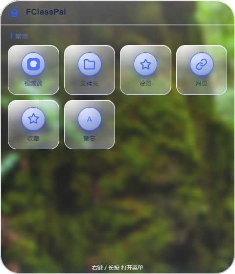

# FClassPal

> FClassPal是一个主要为班级大屏打造的桌面快捷方式启动器小部件 可用于替代希沃管家助手/桌面助手

    

**FClassPal**是一个常驻桌面的启动器小部件，用于替代希沃管家助手/桌面助手 把常用的应用、文件、文件夹和网页钉在桌面一角，顺手管理 U 盘的弹出。无任务栏图标——右键或长按唤醒菜单，其余时间安静地贴在桌面上。

## 使用

双击即用 使用本应用建议卸载希沃桌面助手/隐藏桌面管家（可使用[HugoAura-Enhanced](https://github.com/blingbling-bow/HugoAura-Enhanced)中的功能彻底隐藏掉）

## 功能

- **快捷方式管理**：应用（.exe）/ 文件 / 文件夹 / 网页 / **希沃桌面工具**五种类型；exe 自动提取图标，也可自选图片或字符；支持分组。希沃桌面工具内置批注、日历、随机抽选、人数统计、放大镜、计时、降半屏、截屏八个入口（图标对齐希沃侧边栏），点一下自动配好名称与图标，启动时在希沃安装目录里自动定位工具，位置特殊也可手动指定 exe 路径
- **图标外观**：填充方式可选「内部」（图片**完整落在边框形状之内**，按内切解留白 `0.2929 × 半径`，带字的图与异形图标都不会被圆边切角）或「裁剪」（填满圆形裁掉多余）；形状可选「跟随主题 / 圆形 / 圆角 / 方形」（圆角可调 4–50%）；边框可选「自动取色」（描边 / 外发光 / 底色都取这张图自己的主色）、「跟随主题」（用当前主题的强调色，换风格、换壁纸自动跟着变）、「透明」或「玻璃白边」，也可以**直接指定颜色**。「内部」下还能开**统一图标风格**：所有图标收敛到同一个颜色，图片按自己的形状染成单色（明暗细节保留，认得出是哪个应用），预设与字符图标直接换色——像 Pixel 的主题图标那样一整套图标统一取色。没开统一风格时，预设图标与字符图标取色退回当前主题的强调色
- **U 盘管理**：自动列出即插 U 盘，一键打开；安全弹出采用五层降级策略（设备节点 → 卷级 IOCTL → Shell 动词 → WMI 卸载 → mountvol），每层都校验盘符真的消失，全失败时给出一键「管理员重试」
- **窗口控制**：透明度、圆角弧度（8–40px）、尺寸、置底、锁定位置、开机自启、隐藏到托盘、隐藏任务栏图标
- **编辑模式**：进编辑模式后直接**拖动图标**排位置（跨分组也行），两个图标拖到一起就**聚合成文件夹**，点文件夹弹出二级菜单管理里面成员；「按名称排序」一键正序 / 倒序（中文拼音序）
- **图标布局**（v2.6.0，v2.6.2 扩展）：默认**网格**自动排布，也可切**自由**布局——每个图标都能拖到任意位置、拖右下角手柄自由拉伸大小，编辑弹窗里还有宽/高滑条精调；**每张卡片还能单独调图标在框内的显示大小（50%–200%）、要不要边框、要不要文字**；「一键整理」按当前窗口重新排整齐，「还原尺寸」位置不动恢复默认大小，「恢复默认」清掉全部自定义回到网格
- **配置备份**（设置面板最下面）：导出 `.fcpc`（软件设置 + 全部分组 / 快捷方式 + 自定义图标）与 `.fcps`（主题方案：元素位置 / 背景图 / 图标设置，包内附可读说明），换电脑导入同格式包即可原样恢复。`.fcpt` 从 v2.5.0 起是**主题包**（独立分发的皮肤，见下）
- **明暗模式**：十套主题都支持明亮 / 黑暗 / **跟随系统**三档。选「跟随系统」时系统在亮暗之间切换（含定时切换、日落到日出）应用立刻跟着变，不用重开；动态配色主题走 Monet 官方暗色方案重算整套角色（主色色相守恒，主题身份色不漂）；固定配色主题只压暗表面、绝不动强调色——Kitty 在暗色下依然是粉的
- **自定义背景图**：可以拿自己的图片当底材，可调模糊（0–40px）、白色蒙版（0–100%）、缩放与位移（合起来就是裁剪）、铺法；背景图同时作为取色源，玻璃配色跟着新底材走
- **壁纸取色**：Material You 官方算法（`QuantizerCelebi` 聚类 → `Score` 打分 → `SchemeTonalSpot` 派生），也支持手动指定主色走同一条派生链路
- **设置分区**（v2.6.2）：设置面板左侧分出**功能设置 / 个性化 / 关于**三段，点左边栏直接跳过去，也能照常上下滑动（高亮自动跟着走）
- **每日随机主题**（v2.6.2）：每次启动按日期挑一套已装主题，同一天内保持不变
- **更新提示**（v2.6.2）：检测到新版本时弹窗展示该版本的更新日志，「忽略此版本」之后不再提示这一版
- **调试模式**（v2.6.2）：长按版本号 1.2 秒进入，多出平台效果预览（本机 / 移动端 / Linux / macOS）、调试台（环境与配置实况）与自定义更新服务器
- **触控优先**：Pointer Events 全链路，长按 = 右键，触摸屏上不闪不抖；按住界面与按钮有白光反馈，调节条的珠子按住会放大

## 内置五套皮肤 + 可安装主题包

从 v2.5.0 起，应用本体只带五套内置皮肤，其余主题以 `.fcpt` **主题包**独立分发
（[FClassPal-theme](https://github.com/fangyugit/FClassPal-theme) 仓库提供规范、
示例与下载）。安装包的 `themes/` 目录**随附三丽鸥角色的 8 套**，可在主题管理里一键
离线安装；另外 5 套（洛天依 / 乐正绫 / 初音未来 / 重音Teto / DS鲸鱼娘）到上面那个
仓库的 Release 下载后导入即可。
设置 → 主题 → **管理主题**：导入 / 删除 / 拖拽排序都在这里。

每套主题**不是同一套壳换色**——都有自己的形状语言、表面处理、按钮样式、圆角半径、模糊强度和按压动效：

图标外观（v2.4.2–v2.4.4 的合力）——「内部」填充 + 圆形 + 边框跟随主题 + 统一图标风格（所有图标统一成主题强调色，Pixel 风格）：




## 技术要点

- **四层玻璃结构**：底材层 → warp 层（只挂 `filter` 与 `backdrop-filter`）→ veil 层（白纱/描边/投影）→ 内容层。折射用预烘焙的 256×256 SVG 位移贴图 + `feDisplacementMap`（standard 模式，借鉴 [liquid-glass-react](https://github.com/rdev/liquid-glass-react)）
- **壁纸取色**：`@material/material-color-utilities` 是 ESM 包，而 Electron 的 asar 不支持 ESM 解析，所以用 esbuild 预打成单文件 CJS（`vendor/monet.js`）
- **窗口圆角**：`transparent: true` + 每像素 alpha（不用 Mica——它与 transparent 互斥，会毁掉圆角且 `backdrop-filter` 采不到）
- **拖动**：Pointer Events + `screenX/screenY` 算位移 + rAF 合并 + 主进程 `setPosition`；拖动期间主进程暂停回推 bounds，避免自激振荡
- **U 盘弹出**：`CM_Get_Parent` 上溯到 USB 父设备节点；卷级走 `FSCTL_LOCK_VOLUME` → `IOCTL_STORAGE_MEDIA_REMOVAL` → `FSCTL_DISMOUNT_VOLUME` → `IOCTL_STORAGE_EJECT_MEDIA`，可移动卷免管理员
- **自定义背景图**：图层与壁纸层同层（`z-index:-1`）但排在它之后，仍在折射层之下，所以 `backdrop-filter` 采样到的就是这张图；白蒙版是同一元素上的第二层 `background-image`，模糊走 `filter: blur()`，缩放走 `transform: scale()`（带 `blur/160` 放大补偿）
- **图标取色**：与壁纸取色同一套 Monet 引擎，但关掉 `Score` 的候选过滤（图标多是低饱和/深色，默认过滤会全部拒掉、塌回回退紫），并跳过透明像素（图标 PNG 带透明留白，一起统计会让主色恒为黑，每个图标都套一圈黑边）；一次 IPC 批量取全部图标的主色，首帧即着色，避免"先主题色再跳图片色"的闪烁
- **图标内切**：`object-fit: contain` 只保证内切于**方框**，方形图的四角依然在圆外。按正方形内切于圆角矩形的解析解留白：`内缩 = 0.2929 × 圆角半径`（`0.2929 = (1 − 1/√2)/2`）。圆角百分比是相对**边框盒**、图片内缩百分比是相对父级**内容盒**，两者换算要过边框宽度；「跟随主题」时圆角由主题决定，必须**实测**再算
- **主题跟随色**：纯 CSS 回退链 `--ic-c: var(--ic-ring-c, var(--t-accent, var(--accent)))`，JS 在「跟随主题」这一档一个颜色变量都不写——没有钩子就不会有陈旧色；外发光 45% / 底色 20% 的透明度用 `color-mix()` 现算，同理免钩子
- **统一图标风格**：统一色由 body 一处下发（逐图标写内联值会把"一个色"拆成 N 份）；图片的形状靠 CSS 蒙版（`--ic-mask`，JS 从元素自己的 `` 取已编码的绝对 URL），蒙版层 `inset: var(--ic-pad)` + `mask-size: contain` 与图片的 `padding + object-fit: contain` **逐像素对齐**（对不齐的症状是统一色飘在图标旁边）；`mix-blend-mode: color` 让色相取统一色、明暗仍来自图标本身（细节留着、认得出应用）；`:has(img)` 保证没有图片的图标不长出这一层（否则 mask 取不到值会退回 none = 整块涂满）

## 测试（922 项断言，九层验证）

| 层 | 命令 | 数量 | 说明 |
|---|---|---|---|
| 源码层 | `node smoke-test.js` | 372 | jsdom 跑 renderer 逻辑 |
| 打包层 | `node _check.js` | 268 | 从 `dist/win-unpacked/resources/app.asar` 解包逐项断言 |
| 取色层 | `node _rt/_palettecheck.js` | 50 | 真 `vendor/monet.js` 产出的 palette 喂真 `renderer/app.js` |
| 真机取色 | `electron _rt/_monetcheck.js` | 48 | 真 Electron + 合成壁纸验 Monet（含明暗两套方案） |
| 真机图形 | `electron _rt/_garblecheck.js` | 64 | 真实产品页逐主题验 `<body>` 计算样式干净 + 81 点命中测试 |
| 真机背景 | `electron _rt/_bgcheck.js` | 22 | 拉起真 `main.js` 验背景图真的能加载、响应不卡 |
| 真机图标 | `electron _rt/_iconcheck.js` | 56 | 合成异形测试图验取色 / 描边 / 外发光 / 底色 / 填充 / 形状 / 内切几何 / 统一风格，读 computed 样式 |
| 拖动落盘 | `electron _rt/_dragcheck.js` | 7 | 真 Electron 验 saveBounds |
| 安卓桥接层 | `electron _rt/_mobilecheck.js` | 17 | 真 Chromium 加载 `mobile/www/`，验桥接注入 / 手机适配 / 配置读写 / 全屏布局 |

全部绿了才交付 exe。

想在构建前预跑打包层的断言（省掉一轮打包往返）：

```bash
node _mksrccheck.js && node _check_src.js    # 由 _check.js 生成源码版，只换读文件的方式
```


## 下载

| 平台 | 产物 | 处理器架构 |
|---|---|---|
| Windows | [FClassPal-2.6.2.exe](https://github.com/fangyugit/FclassPal/releases/download/v2.6.2/FClassPal-2.6.2.exe)（单文件版，约 73MB） | x64 |
| Linux | `FClassPal-2.6.2-linux-x64.tar.gz`| x64 |
| Linux | `FClassPal-2.6.2-linux-arm64.tar.gz` | arm64 |
| Linux | [FClassPal-2.6.2-linux-loong64.tar.gz](https://github.com/fangyugit/FclassPal/releases/download/v2.6.2/FClassPal-2.6.2-linux-loong64.tar.gz)（适配龙芯架构） | LoongArch64 |
| macOS | `FClassPal-2.6.2-mac-x64.dmg` / `.zip`（CI 构建自动附加） | Intel x64 |
| macOS | `FClassPal-2.6.2-mac-arm64.dmg` / `.zip`（CI 构建自动附加） | Apple 芯片（M 系列） |
| Android | `FClassPal-2.6.2-android.apk`| arm64 / armv7 / x86_64 |
| Android | `FClassPal-2.6.2-android-debug.apk`（调试签名，CI 构建自动附加） | arm64 / armv7 / x86_64 |

以上都在 [v2.6.2 发布页](https://github.com/fangyugit/FclassPal/releases/tag/v2.6.2)（上一版与更早的见 [全部版本](https://github.com/fangyugit/FclassPal/releases)）

- 龙芯包解压后执行 `FClassPal-linux-loong64/electron` 即可（这一份的可执行文件仍叫
  `electron`，顶层目录名也沿用它，与其它平台不同）
- 安卓版的用法与能力取舍见 [docs/ANDROID.md](docs/ANDROID.md)（界面与桌面版同源；v2.4.6 起
  支持全屏 / 悬浮窗两种窗口模式，悬浮窗下可用录屏权限做实时屏幕模糊；U 盘弹出为桌面专有）

改动记录见 [CHANGELOG.md](CHANGELOG.md)

## 运行与构建

```bash
npm install

# 开发运行
npm start

# 打包 Windows 便携版（产物：dist/FClassPal-<version>.exe）
npm run build:portable

# 打包 Linux（tar.gz，x64 与 arm64；产物名带架构）
# 注：deb 需要 fpm、AppImage 需要 Linux 原生的 mksquashfs，在 Windows 上都出不来
npm run build:linux

# 打包龙芯（LoongArch64 / loong64）
# electron-builder 的 schema 不认 loong64、官方 Electron 也没有这个架构，
# 所以这一份是把 LoongArch 的 Electron 运行时 + 本应用的 app.asar 拼起来（见 make-loong64.js）
npm run build:loong64

# 打包 macOS（dmg + zip，x64 与 arm64，需要在 macOS 上跑）
npm run build:mac

# 打包安卓 APK（需 JDK 21 + Android SDK，详见 docs/ANDROID.md）
cd mobile && npm install && npx cap add android && node tools/apply-android-overlay.js && node tools/build-apk.js debug
# 正式签名 release（密钥配置见 docs/ANDROID.md）
# cd mobile && node tools/apply-android-overlay.js && node tools/build-apk.js release

# 跑回归测试
node smoke-test.js
node _check.js            # 需先打包
node _rt/_palettecheck.js
```

## 目录结构

```
FclassPal/
├── main.js              # Electron 主进程：窗口 / IPC / U 盘弹出 / 壁纸同步
├── preload.js           # 上下文隔离桥
├── renderer/
│   ├── index.html       # 无边框 UI：主界面 + 右键菜单 + 设置面板 + 弹窗
│   ├── style.css        # 内置五套主题（每套是一份独立设计系统）+ 明暗模式 + 自定义背景图
│   ├── app.js           # 交互逻辑：拖动 / 菜单 / 主题注册表 / 取色应用
│   └── lg-displacement-map.js   # 预烘焙折射位移贴图（MIT © 2025 MAX ROVENSKY）
│   └── theme/           # 角色贴图素材源（v2.5.0 起随主题包分发，asar 已排除）
├── vendor/monet.js      # esbuild 预打包的 Material You 取色（CJS）
├── mobile/              # 安卓壳（Capacitor）：web/ 桥接层 + tools/ 装配与出包脚本
│   └── android-overlay/ # 原生工程定制（PalBridge 插件 / 清单 / 主题 / 启动图标）
├── smoke-test.js        # 源码层回归（372 项）
├── _check.js            # 打包层回归（268 项）
├── _mksrccheck.js       # 由 _check.js 生成源码版 _check_src.js（构建前预跑）
├── CHANGELOG.md         # 更新日志
├── _rt/                 # 运行时验证与素材管线脚本
├── tools/               # 托盘图标生成
└── docs/                # 截图
```

## 声明

### 作者

OrionYU

### AI声明

本项目部分代码由 **WorkBuddy** 生成，在真实设备（希沃 MT41A-JHB）上编译，并已在班级中长时间实际使用。

### 提示

- Windows版本仅支持 Windows 10/11（依赖 DWM 模糊、WMI、Cfgmgr32）
- 安卓/Linux/MacOS版本均未测试是否可用
- 开启「实时桌面模糊」后，系统截图/录屏会看不到本窗口（Windows 采集排除机制所致）
- 「自定义背景图」的白蒙版可以替代模糊达到「虚化但不透出桌面」的效果，两者也能叠加
- `renderer/theme/` 中的三丽鸥角色图片版权归 © Sanrio 及原权利方所有，仅供学习与个人使用，请勿商用
- 液态玻璃的位移贴图来自 [liquid-glass-react](https://github.com/rdev/liquid-glass-react)（MIT）

## License

[MIT](LICENSE) © OrionYU (fangyugit)
